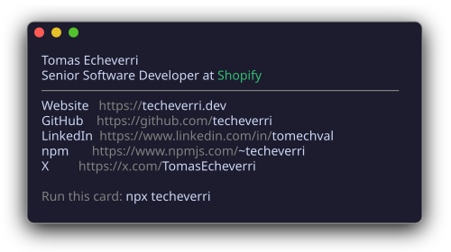
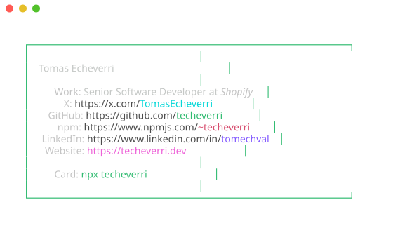

[](https://github.com/techeverri/techeverri-cli/actions/workflows/ci.yml) [](https://www.npmjs.com/package/techeverri)

# Tomas Echeverri

My terminal business card — run `npx techeverri`

| Dark                                                                            | Light                                                                             |
| ------------------------------------------------------------------------------- | --------------------------------------------------------------------------------- |
| [](https://www.npmjs.com/package/techeverri) | [](https://www.npmjs.com/package/techeverri) |

## Usage

```sh
npx techeverri
```

Print a QR code for https://techeverri.dev:

```sh
npx techeverri --qr
```

Requires Node.js 22+

## Development

Requires [Bun](https://bun.sh/)

```sh
bun install
bun run build
bun test
```

Other scripts are in `package.json`

Regenerate the screenshots with `bun run screenshot` (requires Go 1.24+)

Inspired by [bitandbang](https://github.com/bnb/bitandbang)'s card
